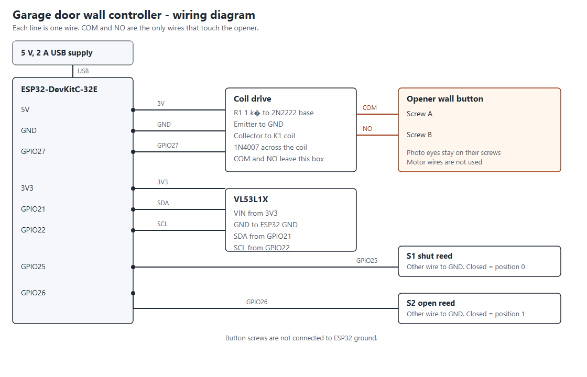

# Garage Door

An Android app that shows whether the garage door is open, asks before it closes, and warns you if the door stays open.

The phone is the remote. Until a wall controller is connected, the app moves a simulated door on a 12-second travel so the screens can be used on their own.

## Screens

- **Door.** A live graphic, the current state (closed, open, opening, closing, or partway), and one primary action. Close always asks you to confirm the doorway is clear. While the door is moving, that action becomes Stop.
- **Activity.** Opens, closes, stops, automatic closes, and left-open alerts.
- **Settings.** How long the door can stay open before an alert, optional auto-close, and a background watch.

## Safety

- Closing sends a command. It does not look at the doorway. The opener's own obstruction sensors are what stop a real door.
- Auto-close is off until you turn it on, and turning it on asks you to confirm that those sensors work.
- Stop is immediate and leaves the door where it is.

## Background watch

With "Watch in the background" on, a foreground service keeps a quiet status notification. If the door stays not fully closed past the alert time (10 minutes by default), you get one high-priority notification for that open period.

The timers run while that service is keeping the app process alive. A hardware controller should send the alert itself if the phone may be off.

## Controller seam

`GarageController` is the only door API the screens use:

- position `0` is shut, `1` is fully open
- commands are open, close, and stop

`SimulatedGarageController` is the stand-in. Replace it inside `DoorRepository` when a real controller can report position and accept those three commands.

## Wall controller

The phone does not drive the motor. A wall unit next to the opener pulses the existing wall button and reports position. The opener keeps its motor and photo eyes.

One button contact handles every command. GPIO27 high for 400 ms closes the relay. Position decides whether that press should start or stop.

Control wires, from the ESP32-DevKitC-32E:

- 5V to the relay coil and the 1N4007 cathode
- GND to the 2N2222 emitter
- GPIO27 through 1 kΩ to the 2N2222 base
- 2N2222 collector to the other coil pin
- Relay COM to one wall-button screw
- Relay NO to the other wall-button screw

Monitor wires:

- 3V3, GND, GPIO21 (SDA), and GPIO22 (SCL) to the VL53L1X
- GPIO25 to the shut reed, return to GND; closed switch is position 0
- GPIO26 to the open reed, return to GND; closed switch is position 1

The button screws are not tied to the ESP32 ground. Do not connect this circuit to the motor, the mains, or the photo-eye terminals.

In Settings, enter the unit's home address (for example `192.168.1.50`) and the access code from `firmware/garage_wall/garage_wall.ino`. Leave the address blank to keep using the practice door. Do not publish port 8080 on the internet. The access code is the only lock, and it is sent only inside your home network or a private tunnel.

Away from home, the phone reaches that same address through [Tailscale](https://tailscale.com/). Install Tailscale on the phone and on a computer that stays on at home, and sign both in to the same account. On the home computer, share the home network (for a `192.168.0.x` address, that is `192.168.0.0/24`) and approve that route in the Tailscale admin console. The wall unit is not given its own public address. Settings in the app has an Install Tailscale button.

## Run

Open this folder in Android Studio (current stable, with Android SDK 37) and run the **app** configuration on a phone or emulator. The first launch asks for notification permission so the background watch can post.

This project uses Android Gradle Plugin 9.4.0, Gradle 9.6, and Jetpack Compose.
