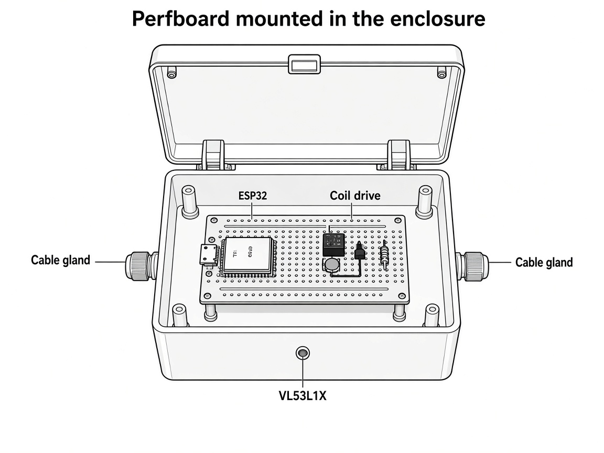
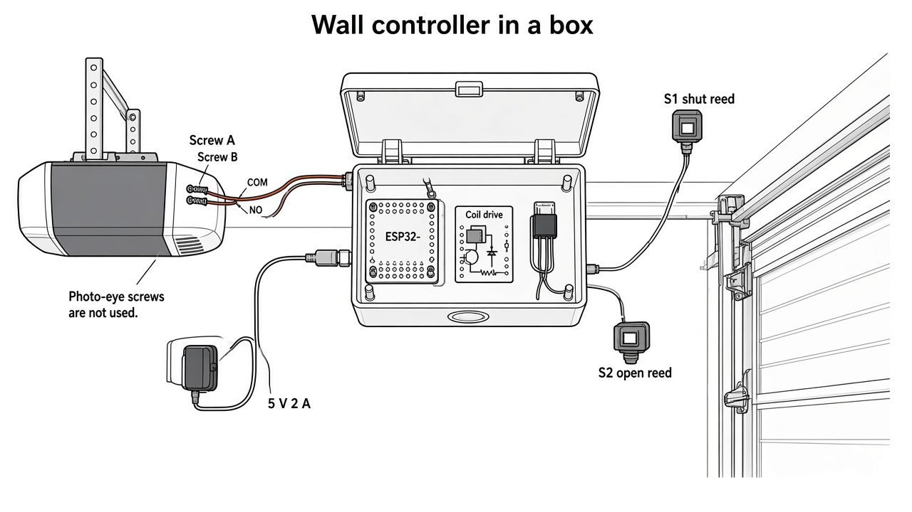
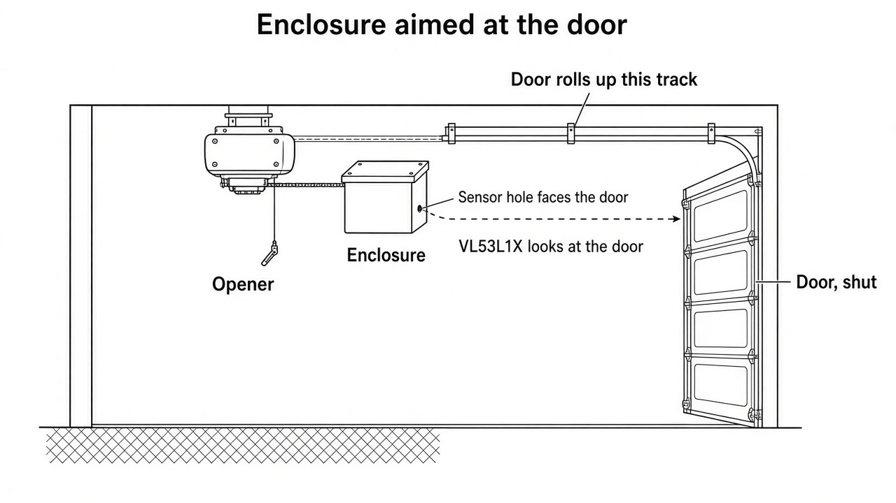
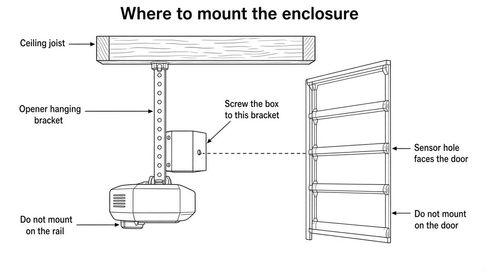
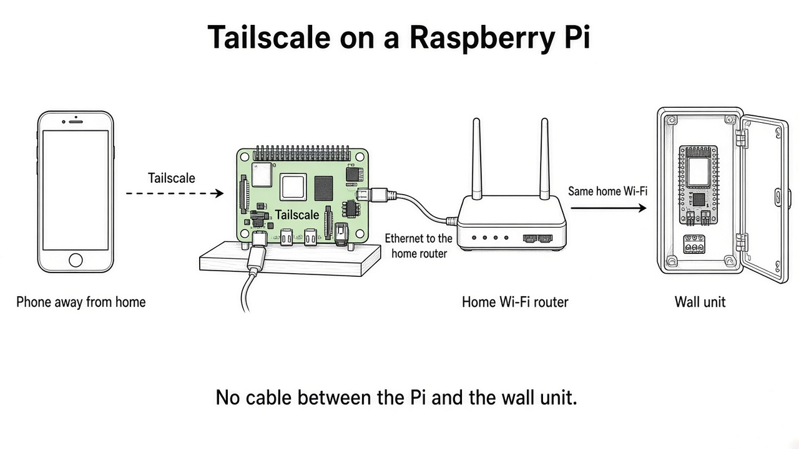

# Garage Door

An Android app that shows whether the garage door is open, asks before it closes, and warns you if the door stays open.

The phone is the remote. Until a wall controller is connected, the app moves a simulated door on a 12-second travel so the screens can be used on their own.

## Screens

- **Door.** A live graphic, the current state (closed, open, opening, closing, or partway), and one primary action. Close always asks you to confirm the doorway is clear. While the door is moving, that action becomes Stop.
- **Activity.** Opens, closes, stops, automatic closes, and left-open alerts.
- **Settings.** How long the door can stay open before an alert, optional auto-close, and a background watch.

## Safety

- Closing sends a command. It does not look at the doorway. The opener's own obstruction sensors are what stop a real door.
- Auto-close is off until you turn it on, and turning it on asks you to confirm that those sensors work.
- Stop is immediate and leaves the door where it is.

## Background watch

With "Watch in the background" on, a foreground service keeps a quiet status notification. If the door stays not fully closed past the alert time (10 minutes by default), you get one high-priority notification for that open period.

The timers run while that service is keeping the app process alive. A hardware controller should send the alert itself if the phone may be off.

## Controller seam

`GarageController` is the only door API the screens use:

- position `0` is shut, `1` is fully open
- commands are open, close, and stop

`SimulatedGarageController` is the stand-in. Replace it inside `DoorRepository` when a real controller can report position and accept those three commands.

## Wall controller

The phone does not drive the motor. A wall unit next to the opener pulses the existing wall button and reports position. The opener keeps its motor and photo eyes.

The ESP32 and the coil drive sit on one perfboard screwed into a project box next to the opener. The distance sensor looks out through a hole toward the door. The reed switches stay on the door: the shut switch where the door is closed, and the open switch where the door stops when fully open.

Screw the box to the opener's hanging bracket, the perforated strap between the ceiling joist and the motor. The sensor hole faces the closed door. Leave the door and its rail alone.

One button contact handles every command. GPIO27 high for 400 ms closes the relay. Position decides whether that press should start or stop.

Control wires, from the ESP32-DevKitC-32E:

- 5V to the relay coil and the 1N4007 cathode
- GND to the 2N2222 emitter
- GPIO27 through 1 kΩ to the 2N2222 base
- 2N2222 collector to the other coil pin
- Relay COM to one wall-button screw
- Relay NO to the other wall-button screw

Monitor wires:

- 3V3, GND, GPIO21 (SDA), and GPIO22 (SCL) to the VL53L1X
- GPIO25 to the shut reed, return to GND; closed switch is position 0
- GPIO26 to the open reed, return to GND; closed switch is position 1

The button screws are not tied to the ESP32 ground. Do not connect this circuit to the motor, the mains, or the photo-eye terminals.

In Settings, enter the unit's home address (for example `192.168.1.50`) and the access code from `firmware/garage_wall/garage_wall.ino`. Leave the address blank to keep using the practice door. Do not publish port 8080 on the internet. The access code is the only lock, and it is sent only inside your home network or a private tunnel.

Away from home, the phone reaches that same address through [Tailscale](https://tailscale.com/). Install Tailscale on the phone and on a Raspberry Pi that stays on at home, and sign both in to the same account. Plug the Pi into the home router with Ethernet. On the Pi, share the home network (for a `192.168.0.x` address, that is `192.168.0.0/24`) and approve that route in the Tailscale admin console. The wall unit stays on the same home Wi-Fi. There is no cable between the Pi and the wall unit, and the wall unit is not given its own public address. Settings in the app has an Install Tailscale button.

## Parts

Single-unit prices from the seller pages on 19 Oct 2026. Tax and shipping are extra. The wall unit is $66.83 without the distance sensor. The sensor adds $14.95. The Raspberry Pi path is $86.70. All three groups are $168.48.

### Wall unit

| Qty | Component | Buy this | Where | Each | Line |
| --- | --- | --- | --- | --- | --- |
| 1 | Controller board | ESP32-DEVKITC-32E | [Digi-Key 1965-ESP32-DEVKITC-32E-ND](https://www.digikey.com/en/products/detail/espressif-systems/ESP32-DEVKITC-32E/12091810) | $10.00 | $10.00 |
| 2 | Reed switch and magnet | Adafruit 375, normally open | [Adafruit 375](https://www.adafruit.com/product/375) | $3.95 | $7.90 |
| 1 | Relay | TE ORWH-SH-105D1F,000, 5 V coil | [Digi-Key PB2032-ND](https://www.digikey.com/en/products/result?keywords=PB2032-ND) | $3.61 | $3.61 |
| 1 | Transistor | 2N2222A, TO-92 | [Digi-Key 4878-2N2222ACT-ND](https://www.digikey.com/en/products/result?keywords=4878-2N2222ACT-ND) | $0.18 | $0.18 |
| 1 | Resistor | 1 kΩ, 1/4 W, 5% | [Digi-Key CF14JT1K00CT-ND](https://www.digikey.com/en/products/detail/stackpole-electronics-inc/CF14JT1K00/1741314) | $0.10 | $0.10 |
| 1 | Diode | 1N4007 | [Digi-Key 4878-1N4007CT-ND](https://www.digikey.com/en/products/result?keywords=4878-1N4007CT-ND) | $0.14 | $0.14 |
| 1 | 5 V, 2 A supply | USB-A wall charger. Adafruit 1994 is $7.95 and out of stock. | [SparkFun USB Wall Charger](https://www.sparkfun.com/usb-wall-charger-5v-2a.html) | $9.50 | $9.50 |
| 1 | USB data cable | USB-A to Micro-USB, 3 ft. Powers and programs the ESP32. | [Adafruit 592](https://www.adafruit.com/product/592) | $2.95 | $2.95 |
| 1 | Enclosure | 5 × 7 × 3 in weatherproof box, clear lid | [Adafruit 905](https://www.adafruit.com/product/905) | $19.95 | $19.95 |
| 1 | Perfboard | Half-size Perma-Proto, sold as a 3-pack. Use one. | [Adafruit 571](https://www.adafruit.com/product/571) | $12.50 | $12.50 |

A short pair of wires from the relay to the opener's wall-button screws is not a separate catalog part.

### Optional distance sensor

| Qty | Component | Buy this | Where | Each | Line |
| --- | --- | --- | --- | --- | --- |
| 1 | Distance sensor | Adafruit VL53L1X breakout. Skip it and the reeds still report shut and open. | [Adafruit 3967](https://www.adafruit.com/product/3967) | $14.95 | $14.95 |

### Raspberry Pi for remote access

| Qty | Component | Buy this | Where | Each | Line |
| --- | --- | --- | --- | --- | --- |
| 1 | Raspberry Pi 3 Model B+ | Board with built-in Ethernet. Adafruit 3775 is the same board at $54.00. | [SparkFun Raspberry Pi 3 B+](https://www.sparkfun.com/raspberry-pi-3-b.html) | $43.50 | $43.50 |
| 1 | Pi power supply | 5 V, 2.5 A, Micro-USB cable included | [Adafruit 1995](https://www.adafruit.com/product/1995) | $8.25 | $8.25 |
| 1 | microSD card | 32 GB Class 10, blank. SparkFun warns this memory price is unstable. | [SparkFun COM-19041](https://www.sparkfun.com/microsd-card-32gb-class-10.html) | $34.95 | $34.95 |

Also use a short Ethernet cable from the Pi to the home router. Tailscale's personal plan has no charge. Digi-Key's 2N2222A single-unit price is $0.18. Its UK page shows the same part at £0.14. The 32 GB card at $34.95 is a shortage listing; a plain 32 GB Class 10 card from another shop is the same part for this Pi.

## Run

Open this folder in Android Studio (current stable, with Android SDK 37) and run the **app** configuration on a phone or emulator. The first launch asks for notification permission so the background watch can post.

This project uses Android Gradle Plugin 9.4.0, Gradle 9.6, and Jetpack Compose.
